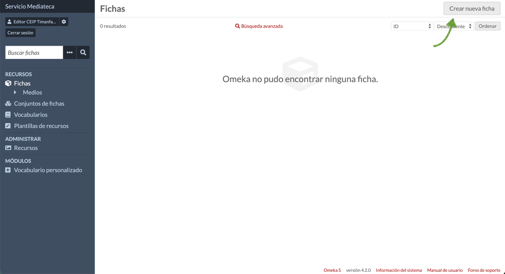
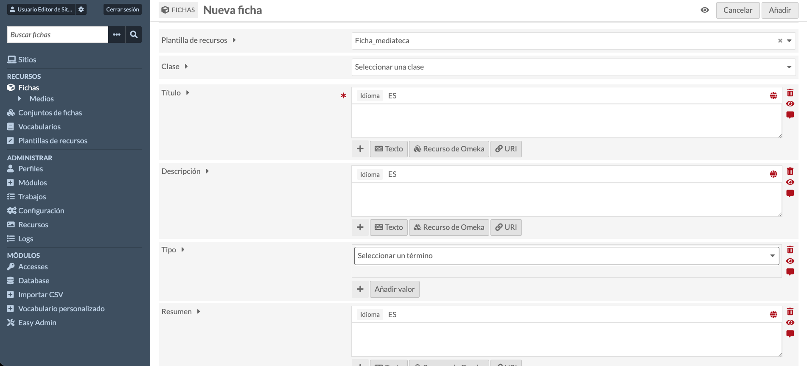
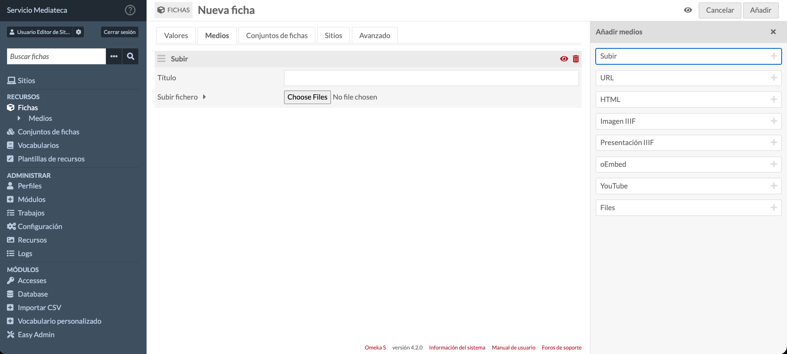
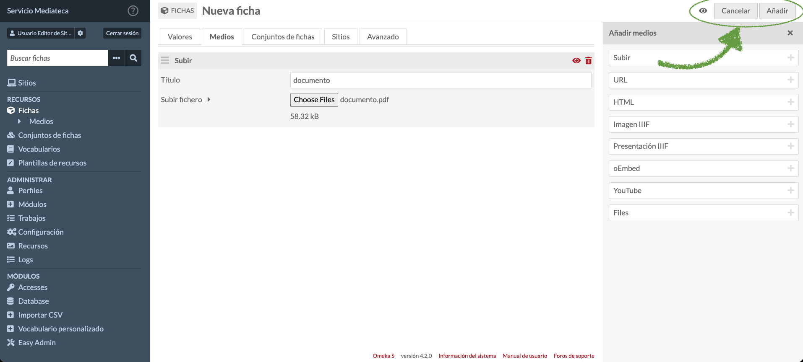

# 4. Crear y gestionar fichas

## 4.1. Crear una nueva ficha

Para añadir un nuevo recurso a la Mediateca:

1.  En el menú lateral, haga clic en 'Fichas'.

2.  Haga clic en el botón 'Crear nueva ficha'.

3.  Se abrirá el formulario de creación de ficha con varias pestañas.

### 4.1.1. Pestaña de valores (metadatos)

En la primera pestaña, complete los campos de metadatos. Por defecto, tendrá asignada la plantilla 'Ficha_Mediateca' que contendrá los siguientes campos:

- **Título \[dcterms:title\] (obligatorio):** título descriptivo y claro del recurso. **Ejemplo:** *'Presentación sobre el Sistema Solar - 3º ESO'* o *'Guía didáctica: La fotosíntesis'*

- **Tipo \[dcterms:type\]:** categoría o formato del recurso, mediante desplegable.

- **Descripción \[dcterms:description\]:** breve resumen del contenido y su utilidad educativa. Debe ser lo más concreto posible. **Ejemplo:** *'Presentación utilizada en la unidad didáctica sobre el sistema solar. Incluye información sobre planetas, satélites y características principales.'*

- **Resumen \[dcterms:abstract\]:** resumen más detallado del contenido y su utilidad educativa.

- **Derechos \[dcterms:rights\]:** información sobre los derechos sobre el recurso (ver sección 4.2 sobre protección de datos y consentimientos).

- **Creador/Autor \[dcterms:creator\]:** nombre de la persona o institución que creó el recurso. **Ejemplo:** *'María García López'* o *'Departamento de Ciencias'*

- **Materia/Tema \[dcterms:subject\]:** palabras clave o temas. Admite múltiples valores ('Añadir valor').

- **Relación \[dcterms:relation\]:** referencias o etiquetas que relacionan el recurso con otros recursos que tienen las mismas etiquetas. **Ejemplo:** *'Astronomía', 'Sistema Solar', 'Ciencias Naturales', '3º ESO'*

**Consejo:** utilice términos consistentes. Si varios recursos son del mismo tipo o tema, use exactamente las mismas palabras clave. Esto facilita las búsquedas y agrupaciones.

### 4.1.2. Pestaña de medios

En la segunda pestaña, puede añadir archivos o enlaces:

1.  Haga clic en la pestaña 'Medios'.

2.  Haga clic en 'Añadir medios'.

3.  Seleccione el tipo de medio:

    - **Subir:** para archivos locales (imágenes, PDF, vídeos, documentos)

    - **URL:** para descargar el contenido desde enlaces a recursos externos

    - **HTML:** para añadir contenido HTML

    - **Imagen o Presentación IIIF:** enlace a imagen o presentación en formato International Image Interoperability Framework

    - **oEmbed:** para insertar contenido embebido de plataformas compatibles (inserción de contenido de otras plataformas)

    - **YouTube:** para añadir un vídeo de YouTube

    - **Files:** para subir archivos locales. Permite arrastrar y soltar archivos (drag & drop) y subir directorios completos

4.  Si sube un archivo, haga clic en 'Seleccionar archivos' y localícelo en su ordenador.

5.  Espere a que el archivo se cargue completamente.

6.  Puede añadir varios medios a la misma ficha si es necesario.

## 4.2. Protección de datos y consentimientos

Antes de subir cualquier imagen, vídeo o documento que contenga datos personales de cualquier persona, debe asegurarse de que:

- **Cuenta con el consentimiento informado de la persona implicada.** Modelo de consentimiento nº 1 de la Consejería de Educación, Formación Profesional, Actividad Física y Deportes (CEFPAFD).

- **No sube contenido de personas que han denegado el consentimiento** o lo han revocado.

- **No comparte categorías especiales de datos (salud, origen étnico, creencias religiosas, datos biométricos, entre otras).**

**Recomendaciones para proteger la privacidad:**

- Evite planos cercanos de rostros cuando sea posible.

- Utilice imágenes de grupo donde los individuos no sean fácilmente identificables.

- No incluya nombres completos, direcciones u otra información personal en los metadatos si no es necesario.

- Revise el contenido de documentos antes de subirlos para asegurar que no contienen información confidencial o de categorías especiales.

- Si tiene dudas, consulte la normativa aplicable (RGPD, LOPDGDD) y las guías de la CEFPAFD, o contacte con el Delegado de Protección de Datos de la Consejería.

**Recordatorio importante:** si una familia o persona retira su consentimiento, debe eliminar inmediatamente el contenido afectado. En caso de duda, consulte al equipo directivo o a las instancias autorizadas en materia de protección de datos.

## 4.3. Guardar y publicar la ficha

**Estado predeterminado:** la Mediateca crea las fichas como públicas por defecto, lo que significa que serán visibles en el sitio público. Si desea preparar la ficha antes de publicarla, puede controlar su visibilidad.

Una vez completados los metadatos y añadidos los medios:

1.  Revise toda la información introducida.

2.  Si desea que la ficha no sea visible en la vista pública todavía, haga clic en el icono con forma de ojo, situado junto al botón 'Cancelar', para marcarla como privada.

3.  En la esquina superior derecha, haga clic en el botón 'Añadir' o 'Guardar' para crear la ficha.

4.  Verá un mensaje de confirmación indicando que la ficha se ha creado correctamente.

**Nota:** en la sección 4.5 encontrará información detallada sobre cómo controlar la visibilidad de las fichas.

## 4.4. Editar una ficha existente

Para modificar una ficha ya creada:

1.  En el menú lateral, haga clic en 'Fichas'.

2.  Localice la ficha que desea editar (puede usar la búsqueda).

3.  Haga clic en el título de la ficha o en el icono de edición (lápiz).

4.  Realice las modificaciones necesarias en cualquiera de las pestañas.

5.  Haga clic en 'Guardar' para aplicar los cambios.

### 4.4.1. Modificar medios

Para modificar los archivos adjuntos de una ficha:

- **Añadir nuevos medios:** en la pestaña 'Medios', seleccione el tipo de medio que desea añadir.

- **Eliminar medios:** haga clic en el icono de eliminación junto al medio que desea quitar.

- **Reemplazar medios:** elimine el medio antiguo y añada el nuevo.

## 4.5. Controlar la visibilidad de fichas

Puede controlar si una ficha es visible en el sitio público o permanece privada. Al crear o editar una ficha, pulse el icono con forma de ojo en la parte superior derecha:

1.  **Público:** la ficha es visible para todos los visitantes del sitio de la Mediateca.

2.  **Privado:** la ficha solo es visible para usuarios con sesión iniciada en el panel de administración.

**Consejo:** puede crear fichas con visibilidad privada mientras las prepara y cambiar a visibilidad pública cuando estén listas para compartirse con la comunidad educativa.
