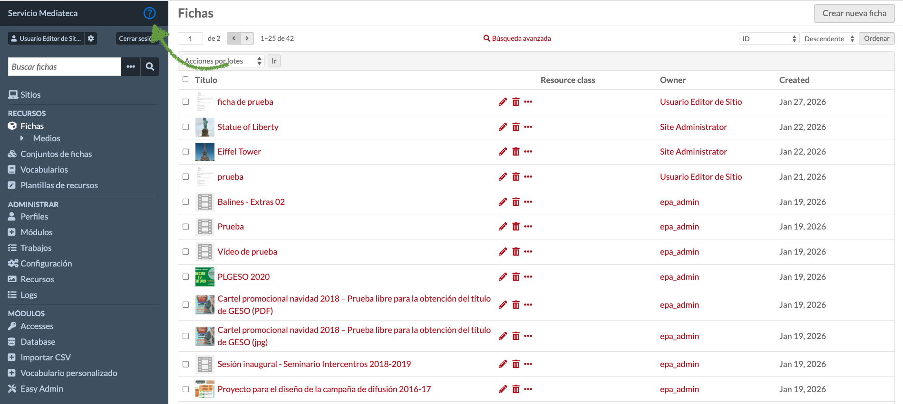

# 9. Ayuda y soporte

## 9.1. Ayuda contextual

La Mediateca incluye ayuda contextual integrada. Busque el icono de interrogación en la parte superior izquierda en diferentes secciones del panel de administración para obtener información específica sobre cada función.

## 9.2. Soporte

Para incidencias técnicas o dudas no resueltas con la ayuda contextual, el CAU_CE (Centro de Atención de Usuarios de la Consejería de Educación) pone a su disposición varias vías para crear y hacer seguimiento de incidencias relacionadas con la Mediateca:

- **Consola de Servicios**: a través del servicio ["Creación de incidencias"](https://www3.gobiernodecanarias.org/educacion/cau_ce/servicios/mis-servicios/creacion-de-incidencias), disponible en la Consola de Servicios, puede generar su incidencia sin necesidad de interactuar con un técnico. Tras unas sencillas selecciones, se recoge la información relevante para que el personal técnico del CAU_CE la atienda y resuelva. El mismo servicio está disponible desde el móvil, con idéntica funcionalidad.

- **Llamada telefónica**:

  - Horario: de 7:00 a 22:00 horas en días laborables.

  - Teléfonos: 922-922-912, 928-117-912 y 902-111-912 (marcando solo 912 desde la red corporativa).

- **Correo electrónico**: cibercentro@gobiernodecanarias.org

- **Seguimiento de incidencias**: independientemente del canal utilizado para crearla, puede consultar el estado de su incidencia en ["Mis incidencias"](https://www3.gobiernodecanarias.org/educacion/cau_ce/servicios/mis-incidencias), en el Área privada de la Consola de Servicios del CAU_CE.
