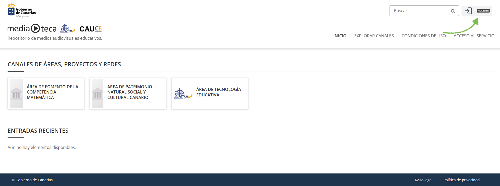
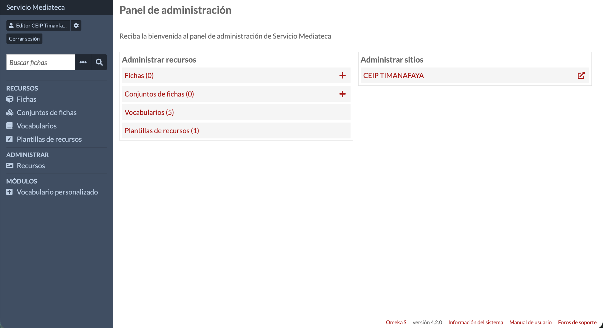
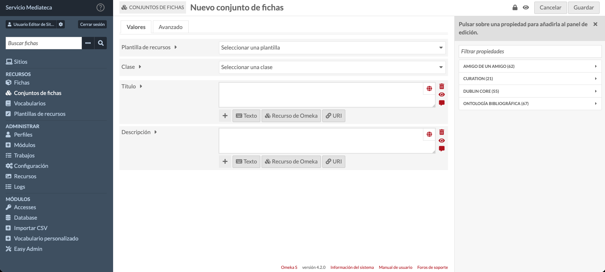
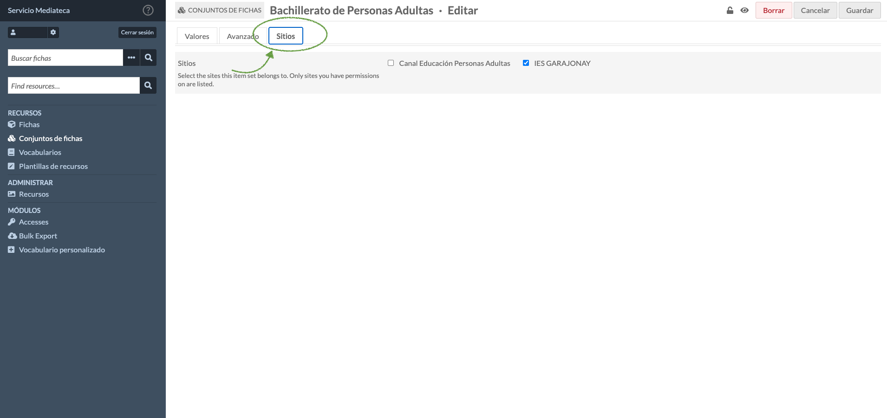
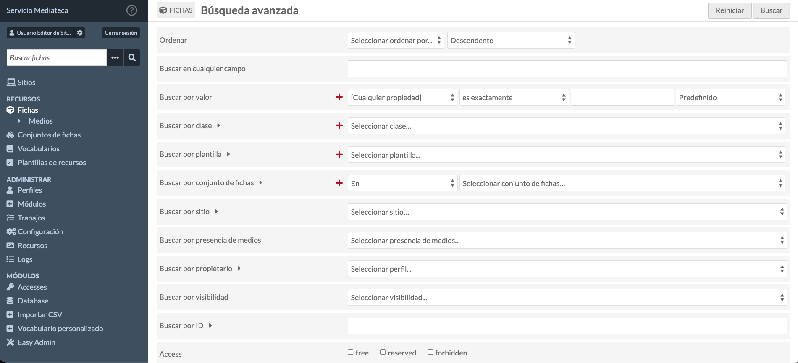

# 1. Introducción a la Mediateca

## 1.1. ¿Qué es la Mediateca?

El servicio de Mediateca es una plataforma de gestión de colecciones digitales que permite alojar, catalogar y difundir materiales audiovisuales y sonoros de carácter educativo (vídeos, pódcast, infografías, fotografías y presentaciones interactivas), dirigida a centros educativos, áreas, servicios, programas y otras instancias educativas.

Cada centro educativo, área, servicio o programa dispone de su propio canal de mediateca: el espacio dentro de la plataforma donde gestiona y publica sus propios contenidos.

## 1.2. Objetivos del servicio de Mediateca

El servicio de Mediateca tiene como objetivos principales:

- Centralizar y organizar los materiales audiovisuales y sonoros de carácter educativo generados por el centro.

- Catalogar profesionalmente estos recursos para facilitar su búsqueda y recuperación.

- Preservar y difundir el patrimonio educativo y cultural del centro, como una de las finalidades de uso de la plataforma.

## 1.3. Perfil de usuario: Editor de Sitio

Con el perfil de 'Editor de Sitio', tiene permisos para crear, editar y gestionar contenidos dentro del canal de Mediateca de su centro. Sus tareas incluyen:

- Crear y catalogar fichas.

- Subir y gestionar archivos multimedia.

- Organizar contenidos en colecciones temáticas.

- Controlar la visibilidad y publicación de recursos.

- Mantener actualizada la información de la Mediateca.

# 2. Acceso al canal de mediateca

## 2.1. Cómo acceder al panel de administración

Para acceder al panel de administración de la Mediateca:

1.  Desde su navegador web (se recomienda Firefox, Chrome o Edge actualizados) acceda a [https://www3.gobiernodecanarias.org/medusa/mediateca/](https://www3.gobiernodecanarias.org/medusa/mediateca/)

2.  Si ya ha iniciado sesión verá su nombre de usuario en la esquina superior derecha de la ventana. Pulse sobre el icono de usuario o sobre su nombre para acceder al panel de administración.

3.  Si no se ha identificado previamente como usuario, pulse el botón 'Acceder'. Deberá introducir sus credenciales de acceso en la pantalla de inicio de sesión en CAS (Servicio Central de Autenticación), que se abrirá automáticamente.

## 2.2. El panel de administración

Una vez iniciada la sesión, se accede al panel de administración. Este panel muestra:

- **Menú lateral izquierdo:** navegación principal con acceso a fichas, conjuntos de fichas (colecciones) y otras funciones

- **Área central:** información resumida sobre los contenidos de su canal de mediateca

- **Barra superior:** acceso a su perfil, ayuda y opciones de sesión

# 3. Conceptos básicos de la Mediateca

Antes de comenzar a trabajar con la Mediateca, es importante comprender algunos conceptos fundamentales y cómo se relacionan entre sí: una ficha contiene metadatos (información descriptiva) y medios (archivos adjuntos); varias fichas se agrupan en colecciones.

## 3.1. Fichas

La ficha es la unidad básica de información que representa un recurso digital: documentos, imágenes, vídeos, audios, enlaces o combinaciones de estos elementos.

Cada ficha contiene información descriptiva (metadatos) y puede contener archivos adjuntos (medios).

## 3.2. Medios

Los medios son los archivos físicos asociados a una ficha. Una ficha puede contener:

- Un medio único (por ejemplo: un solo PDF)

- Varios medios (por ejemplo: varias imágenes de una misma actividad, o un documento con su versión en audio)

## 3.3. Valores o metadatos

Los metadatos son la información descriptiva de una ficha. Son como las fichas de una biblioteca tradicional, pero mucho más completas. Los metadatos incluyen:

- **Título:** nombre del recurso

- **Descripción:** resumen del contenido

- **Creador/Autor:** nombre de la persona creadora del recurso

- **Fecha:** fecha de creación del recurso

- **Materia:** temas o palabras clave

- **Tipo:** categoría del recurso

- **Derechos:** información sobre uso y licencias

**Importante:** completar correctamente los metadatos es fundamental para que los recursos se puedan encontrar fácilmente. Una buena catalogación hace que la Mediateca sea realmente útil para toda la comunidad educativa.

## 3.4. Conjuntos de fichas o colecciones

Las colecciones son agrupaciones temáticas de fichas. Permiten organizar recursos relacionados. Algunos ejemplos de colecciones en un contexto educativo pueden ser:

- Proyecto STEAM 2024-25

- Recursos de Lengua y Literatura

- Salidas educativas y excursiones

- Materiales de Ciencias Naturales

- Actividades extraescolares curso 2024-25

Una misma ficha puede pertenecer a varias colecciones si es relevante para múltiples áreas.

# 4. Crear y gestionar fichas

## 4.1. Crear una nueva ficha

Para añadir un nuevo recurso a la Mediateca:

1.  En el menú lateral, haga clic en 'Fichas'.

2.  Haga clic en el botón 'Crear nueva ficha'.

3.  Se abrirá el formulario de creación de ficha con varias pestañas.

### 4.1.1. Pestaña de valores (metadatos)

En la primera pestaña, complete los campos de metadatos. Por defecto, tendrá asignada la plantilla 'Ficha_Mediateca' que contendrá los siguientes campos:

- **Título \[dcterms:title\] (obligatorio):** título descriptivo y claro del recurso. **Ejemplo:** *'Presentación sobre el Sistema Solar - 3º ESO'* o *'Guía didáctica: La fotosíntesis'*

- **Tipo \[dcterms:type\]:** categoría o formato del recurso, mediante desplegable.

- **Descripción \[dcterms:description\]:** breve resumen del contenido y su utilidad educativa. Debe ser lo más concreto posible. **Ejemplo:** *'Presentación utilizada en la unidad didáctica sobre el sistema solar. Incluye información sobre planetas, satélites y características principales.'*

- **Resumen \[dcterms:abstract\]:** resumen más detallado del contenido y su utilidad educativa.

- **Derechos \[dcterms:rights\]:** información sobre los derechos sobre el recurso (ver sección 4.2 sobre protección de datos y consentimientos).

- **Creador/Autor \[dcterms:creator\]:** nombre de la persona o institución que creó el recurso. **Ejemplo:** *'María García López'* o *'Departamento de Ciencias'*

- **Materia/Tema \[dcterms:subject\]:** palabras clave o temas. Admite múltiples valores ('Añadir valor').

- **Relación \[dcterms:relation\]:** referencias o etiquetas que relacionan el recurso con otros recursos que tienen las mismas etiquetas. **Ejemplo:** *'Astronomía', 'Sistema Solar', 'Ciencias Naturales', '3º ESO'*

**Consejo:** utilice términos consistentes. Si varios recursos son del mismo tipo o tema, use exactamente las mismas palabras clave. Esto facilita las búsquedas y agrupaciones.

### 4.1.2. Pestaña de medios

En la segunda pestaña, puede añadir archivos o enlaces:

1.  Haga clic en la pestaña 'Medios'.

2.  Haga clic en 'Añadir medios'.

3.  Seleccione el tipo de medio:

    - **Subir:** para archivos locales (imágenes, PDF, vídeos, documentos)

    - **URL:** para descargar el contenido desde enlaces a recursos externos

    - **HTML:** para añadir contenido HTML

    - **Imagen o Presentación IIIF:** enlace a imagen o presentación en formato International Image Interoperability Framework

    - **oEmbed:** para insertar contenido embebido de plataformas compatibles (inserción de contenido de otras plataformas)

    - **YouTube:** para añadir un vídeo de YouTube

    - **Files:** para subir archivos locales. Permite arrastrar y soltar archivos (drag & drop) y subir directorios completos

4.  Si sube un archivo, haga clic en 'Seleccionar archivos' y localícelo en su ordenador.

5.  Espere a que el archivo se cargue completamente.

6.  Puede añadir varios medios a la misma ficha si es necesario.

## 4.2. Protección de datos y consentimientos

Antes de subir cualquier imagen, vídeo o documento que contenga datos personales de cualquier persona, debe asegurarse de que:

- **Cuenta con el consentimiento informado de la persona implicada.** Modelo de consentimiento nº 1 de la Consejería de Educación, Formación Profesional, Actividad Física y Deportes (CEFPAFD).

- **No sube contenido de personas que han denegado el consentimiento** o lo han revocado.

- **No comparte categorías especiales de datos (salud, origen étnico, creencias religiosas, datos biométricos, entre otras).**

**Recomendaciones para proteger la privacidad:**

- Evite planos cercanos de rostros cuando sea posible.

- Utilice imágenes de grupo donde los individuos no sean fácilmente identificables.

- No incluya nombres completos, direcciones u otra información personal en los metadatos si no es necesario.

- Revise el contenido de documentos antes de subirlos para asegurar que no contienen información confidencial o de categorías especiales.

- Si tiene dudas, consulte la normativa aplicable (RGPD, LOPDGDD) y las guías de la CEFPAFD, o contacte con el Delegado de Protección de Datos de la Consejería.

**Recordatorio importante:** si una familia o persona retira su consentimiento, debe eliminar inmediatamente el contenido afectado. En caso de duda, consulte al equipo directivo o a las instancias autorizadas en materia de protección de datos.

## 4.3. Guardar y publicar la ficha

**Estado predeterminado:** la Mediateca crea las fichas como públicas por defecto, lo que significa que serán visibles en el sitio público. Si desea preparar la ficha antes de publicarla, puede controlar su visibilidad.

Una vez completados los metadatos y añadidos los medios:

1.  Revise toda la información introducida.

2.  Si desea que la ficha no sea visible en la vista pública todavía, haga clic en el icono con forma de ojo, situado junto al botón 'Cancelar', para marcarla como privada.

3.  En la esquina superior derecha, haga clic en el botón 'Añadir' o 'Guardar' para crear la ficha.

4.  Verá un mensaje de confirmación indicando que la ficha se ha creado correctamente.

**Nota:** en la sección 4.5 encontrará información detallada sobre cómo controlar la visibilidad de las fichas.

## 4.4. Editar una ficha existente

Para modificar una ficha ya creada:

1.  En el menú lateral, haga clic en 'Fichas'.

2.  Localice la ficha que desea editar (puede usar la búsqueda).

3.  Haga clic en el título de la ficha o en el icono de edición (lápiz).

4.  Realice las modificaciones necesarias en cualquiera de las pestañas.

5.  Haga clic en 'Guardar' para aplicar los cambios.

### 4.4.1. Modificar medios

Para modificar los archivos adjuntos de una ficha:

- **Añadir nuevos medios:** en la pestaña 'Medios', seleccione el tipo de medio que desea añadir.

- **Eliminar medios:** haga clic en el icono de eliminación junto al medio que desea quitar.

- **Reemplazar medios:** elimine el medio antiguo y añada el nuevo.

## 4.5. Controlar la visibilidad de fichas

Puede controlar si una ficha es visible en el sitio público o permanece privada. Al crear o editar una ficha, pulse el icono con forma de ojo en la parte superior derecha:

1.  **Público:** la ficha es visible para todos los visitantes del sitio de la Mediateca.

2.  **Privado:** la ficha solo es visible para usuarios con sesión iniciada en el panel de administración.

**Consejo:** puede crear fichas con visibilidad privada mientras las prepara y cambiar a visibilidad pública cuando estén listas para compartirse con la comunidad educativa.

# 5. Gestionar colecciones de fichas

Las colecciones (conjuntos de fichas) son fundamentales para organizar los recursos de la Mediateca de forma lógica y accesible. Una buena estructura de colecciones facilita enormemente la navegación y localización de contenidos.

## 5.1. Crear una nueva colección

1.  En el menú lateral, haga clic en 'Conjuntos de Fichas'.

2.  Haga clic en 'Crear nuevo conjunto de fichas'.

3.  Complete los metadatos de la colección:

    - **Título:** nombre descriptivo de la colección.

    - **Descripción:** explique qué tipo de recursos agrupa esta colección.

    - **Otros metadatos:** palabras clave, fechas, etc., según sea relevante.

4.  Haga clic en 'Guardar' para crear la colección.

## 5.2. Añadir fichas a una colección

Hay dos formas de añadir fichas a una colección:

#### Durante la creación de la ficha

1.  Al crear o editar una ficha, busque el campo 'Conjuntos de Fichas'.

2.  Haga clic en el campo y seleccione la(s) colección(es) apropiada(s).

Una ficha puede pertenecer a múltiples colecciones si es relevante.

#### Desde la lista de fichas (edición en lote)

1.  Vaya a 'Fichas' en el menú lateral.

2.  Seleccione varias fichas marcando las casillas correspondientes.

3.  En las opciones de acciones en lote, seleccione 'Editar en lote'.

4.  Añada o quite las colecciones según sea necesario.

5.  Aplique los cambios a todas las fichas seleccionadas.

## 5.3. Ejemplos de colecciones útiles en contexto educativo

Estas son algunas ideas de colecciones para organizar su Mediateca:

- **Por asignatura o área:** Matemáticas, Lengua, Ciencias, Inglés, etc.

- **Por proyecto:** Proyecto STEAM, Semana Cultural, Proyecto de Innovación, etc.

- **Por curso académico:** Curso 2023-24, Curso 2024-25, etc.

- **Por tipo de actividad:** Excursiones, Talleres, Conferencias, Actividades extraescolares, etc.

- **Por nivel educativo:** Infantil, Primaria, ESO, Bachillerato

- **Por tipo de recurso:** Guías didácticas, Vídeos educativos, Materiales manipulativos, etc.

**Recomendación:** planifique la estructura de colecciones antes de empezar a catalogar masivamente. Una estructura consistente y lógica facilitará el trabajo futuro y la búsqueda de recursos.

## 5.4. Asignar una colección a uno o varios sitios

Una colección no aparecerá en un sitio de la Mediateca si no está asignada a ese sitio. Para asignar una colección a uno de sus sitios disponibles, debe seguir los siguientes pasos:

1.  En el formulario de 'Crear nuevo conjunto de fichas' o 'Editar conjunto de fichas' localice la pestaña 'Sitios'.

2.  Verá un listado de casillas de verificación con los sitios sobre los que usted tiene permisos; por motivos de seguridad, únicamente se muestran esos sitios. El propio formulario incluye el siguiente texto de ayuda: 'Seleccione los sitios a los que pertenece esta colección. Solo se listan los sitios sobre los que tiene permisos'.

3.  Marque las casillas de los sitios a los que desea que pertenezca la colección:

    - **Si está creando una colección nueva:** las casillas aparecerán premarcadas según los sitios que tenga configurados como predeterminados en el ajuste personal 'Sitios predeterminados para nuevos ítems', disponible en sus ajustes de usuario. Puede modificar esta selección antes de guardar.

    - **Si está editando una colección existente:** aparecerán marcados, de entre los sitios visibles para usted, aquellos a los que la colección ya está asignada actualmente.

4.  Haga clic en 'Guardar' para confirmar la asignación.

**Nota:** si al abrir la pestaña 'Sitios' no aparece ningún sitio disponible, significa que su usuario no tiene ningún sitio asignado. En ese caso, se mostrará un aviso indicando que debe solicitar a un administrador que le conceda permisos sobre al menos un sitio antes de poder asignar colecciones a sitios.

Esta pestaña solo está disponible para los perfiles con permisos de edición sobre sitios ('Editor de Sitio' y 'Gestor de Sitio'). Si su perfil es de solo lectura ('Investigador de Sitio'), no la verá, ya que no puede modificar asignaciones.

# 6. Buscar y filtrar contenidos en el panel de administración

El panel de administración de la Mediateca incluye herramientas de búsqueda que le permiten localizar rápidamente cualquier ficha o colección.

## 6.1. Búsqueda avanzada

Para búsquedas más específicas:

1.  Haga clic en 'Búsqueda avanzada' o en el icono correspondiente.

2.  Podrá buscar por:

    - Campo de metadato específico (título, autor, tema, etc.)

    - Colección

    - Estado de visibilidad (público/privado)

    - Clase de recurso

    - Fecha de creación o modificación

    - Tipo de medio adjunto

3.  Combine múltiples criterios para búsquedas muy precisas.

## 6.2. Filtros y ordenación

En la lista de resultados, puede:

- Ordenar por diferentes campos (título, fecha de creación, fecha de modificación).

- Aplicar filtros rápidos para ver solo fichas públicas o privadas.

# 7. Trabajar con múltiples fichas: acciones en lote

Las acciones en lote permiten modificar varias fichas simultáneamente, ahorrando tiempo en tareas repetitivas.

## 7.1. Seleccionar múltiples fichas

1.  En la lista de fichas, marque las casillas de las fichas que desea modificar.

2.  Puede usar la casilla del encabezado para seleccionar todas las fichas de la página actual.

3.  Combine con filtros de búsqueda para seleccionar fichas específicas.

## 7.2. Operaciones disponibles

Una vez seleccionadas las fichas, puede:

- **Editar en lote:** modificar metadatos comunes de todas las fichas seleccionadas.

- **Añadir a colección:** incluir todas las fichas seleccionadas en una o varias colecciones.

- **Quitar de colección:** eliminar las fichas seleccionadas de colecciones específicas.

- **Cambiar visibilidad:** hacer públicas o privadas múltiples fichas a la vez.

- **Eliminar:** borrar múltiples fichas (use con precaución).

**Precaución:** las acciones en lote afectan a todas las fichas seleccionadas. Verifique cuidadosamente su selección antes de aplicar cambios, especialmente antes de eliminar contenidos. La Mediateca le pedirá que confirme la acción.

# 8. Buenas prácticas y recomendaciones

## 8.1. Catalogación de calidad

- **Sea consistente:** use los mismos términos para temas similares. Si un recurso es de 'Matemáticas', no use 'Mates' en otros recursos de la misma temática.

- **Sea específico:** un título genérico como 'Presentación' no es útil. Use 'Presentación: Tipos de triángulos - 1º ESO'.

- **Use múltiples palabras clave:** facilitan encontrar el recurso desde diferentes búsquedas.

- **Complete todos los campos relevantes:** para una mayor utilidad y mejores resultados en las búsquedas, se recomienda completar todos los campos de información.

- **Revise antes de publicar:** compruebe que no hay errores ortográficos y que la información es correcta.

## 8.2. Organización de colecciones

- **Planifique la estructura:** defina las colecciones principales antes de empezar a catalogar masivamente.

- **Mantenga una jerarquía lógica:** las colecciones deben ser fáciles de entender para cualquier usuario.

- **No cree demasiadas colecciones:** muchas colecciones pequeñas pueden crear más confusión que una menor cantidad de colecciones bien organizadas.

- **Revise periódicamente:** archive o elimine colecciones obsoletas.

## 8.3. Gestión de archivos

- **Optimice el tamaño:** reduzca el tamaño de imágenes y vídeos antes de subirlos para mejorar tiempos de carga.

- **Use formatos compatibles:** PDF para documentos, JPG/PNG para imágenes, MP4 para vídeos.

- **Nombres de archivo descriptivos:** antes de subir, renombre los archivos con nombres claros (p. ej.: `triangulos_1eso_2024.pdf`).

**Nota sobre limitaciones técnicas:** consulte con el administrador del sistema si existe algún límite de tamaño de archivo o restricciones de formato específicas para su instalación.

## 8.4. Mantenimiento y actualización

- **Revise contenidos obsoletos:** archive o elimine recursos antiguos o que ya no sean relevantes.

- **Actualice información:** si un recurso cambia, actualice sus metadatos y archivos.

- **Verifique enlaces externos:** los enlaces a recursos externos pueden dejar de funcionar; conviene hacer revisiones periódicas.

**Nota general:** si varios editores trabajan en el canal de mediateca del centro, establezcan criterios comunes de catalogación para mantener la consistencia descrita en este apartado.

# 9. Ayuda y soporte

## 9.1. Ayuda contextual

La Mediateca incluye ayuda contextual integrada. Busque el icono de interrogación en la parte superior izquierda en diferentes secciones del panel de administración para obtener información específica sobre cada función.

## 9.2. Soporte

Para incidencias técnicas o dudas no resueltas con la ayuda contextual, el CAU_CE (Centro de Atención de Usuarios de la Consejería de Educación) pone a su disposición varias vías para crear y hacer seguimiento de incidencias relacionadas con la Mediateca:

- **Consola de Servicios**: a través del servicio ["Creación de incidencias"](https://www3.gobiernodecanarias.org/educacion/cau_ce/servicios/mis-servicios/creacion-de-incidencias), disponible en la Consola de Servicios, puede generar su incidencia sin necesidad de interactuar con un técnico. Tras unas sencillas selecciones, se recoge la información relevante para que el personal técnico del CAU_CE la atienda y resuelva. El mismo servicio está disponible desde el móvil, con idéntica funcionalidad.

- **Llamada telefónica**:

  - Horario: de 7:00 a 22:00 horas en días laborables.

  - Teléfonos: 922-922-912, 928-117-912 y 902-111-912 (marcando solo 912 desde la red corporativa).

- **Correo electrónico**: cibercentro@gobiernodecanarias.org

- **Seguimiento de incidencias**: independientemente del canal utilizado para crearla, puede consultar el estado de su incidencia en ["Mis incidencias"](https://www3.gobiernodecanarias.org/educacion/cau_ce/servicios/mis-incidencias), en el Área privada de la Consola de Servicios del CAU_CE.
